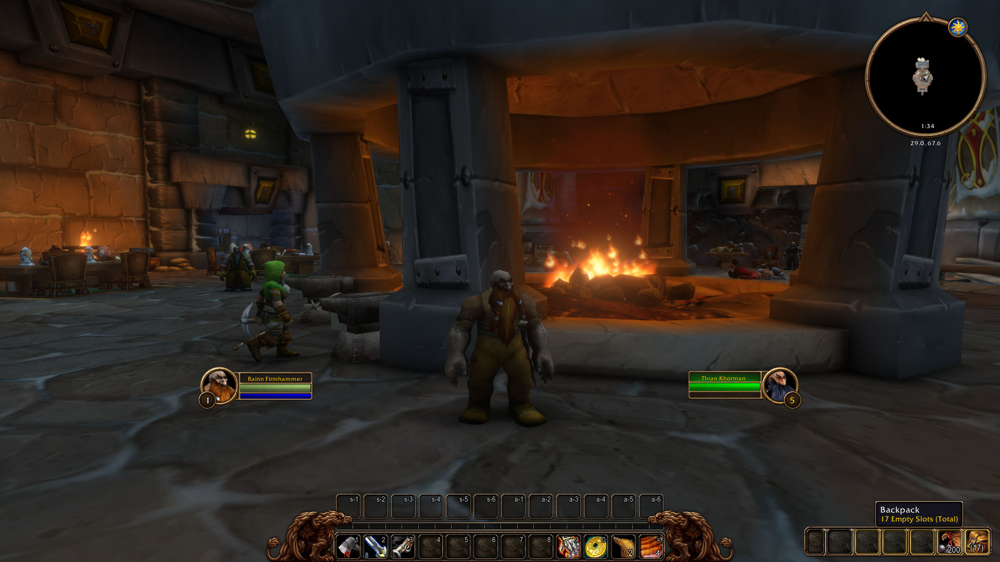

# ErzbaroneUI

A reduced World of Warcraft Forever Interface

## Usage

Extract the `ErzbaroneUI` directory from the release zip into the `World of Warcraft\_forever_\Interface\AddOns\` directory.
To open the configuration, select ErzbaroneUI in the minimap's AddOns menu, go to Game Menu → Options → AddOns → ErzbaroneUI or type `/eui`.

### Via CurseForge

The addon is available on CurseForge too, search for `ErzbaroneUI` or [on their website](https://www.curseforge.com/wow/addons/erzbaroneui).

## Features

- Auto sell grey items
- Auto repair
- Optional vignette effect
- HDR options
- Five second rule timer on the player mana bar
- Optional swing timer spark on the player power bar for melee and ranged fighters
- Textured health and power bars on the unit frames (classic, smooth, skills or a custom `textures\statusbar` file), also selectable for the cast bars
- Class colored health bars for players and grey health bars for creatures tapped by others
- Optionally hides the large threat glow around the player, target and focus frames
- Cast count on action buttons (how often a mana spell can be cast with the current mana)
- Red tint on action buttons while the target is out of range
- Hides the button column left of the chat window
- Hides the chat tabs until the mouse is over the chat window
- Hides the vertical action bars on the right until hovered
- Emote selection beside the mouse cursor, with 24 emotes
- Improved Main Actionbar Layout
- Micro menu position presets
- Hides the bag names in the bag windows
- Compact minimap until the minimap is hovered

## Development

Run the layout regression tests with `lua tests\actionlayout_test.lua`.
They reject all Edit Mode profile API calls and writes to native secure button references. They check native button reuse and modeled clicks/paging, adaptive action/auxiliary-bar placement and stacking, stable stance/shapeshift, pet and possession button positions during native combat reanchoring, divider suppression, immediate XP resizing and marker updates, runtime restoration, resets, reloads and combat deferral.
Auxiliary buttons use stable anchors prepared outside combat while their native containers, visibility and click handlers remain unchanged. Grid and stacking changes during combat are applied after combat ends.
Gryphon anchors are maintained synchronously during native layout updates to avoid briefly reverting to their default positions; tests check this without flushing queued updates.
Actual combat protection still needs testing in the Forever client.
The layout tests also check micro menu position presets, scaled bag alignment, combat-deferred position changes and native placement while the experimental layout is disabled.

Run the AddOns menu integration test with `lua tests\config_test.lua`.

Run the vertical action-bar backdrop and mouseover fade tests with `lua tests\barfade_test.lua`.

Run the emote selection interaction tests with `lua tests\emotes_test.lua`.

## Screenshots

## Credits

- [FiveSecondRule](https://github.com/smp4903/FiveSecondRule) and [WeaponSwingTimer](https://github.com/LeftHandedGlove/WeaponSwingTimerAddon) for the idea of the timer sparks on the power bar
- [wow-ui-source](https://github.com/Gethe/wow-ui-source) by Gethe, the Blizzard interface source used as reference
- [wow-ui-source-forever](https://github.com/Ketho/wow-ui-source-forever/tree/forever) by Ketho, the matching Forever FrameXML reference (upstream live sources differ)
- [Warcraft Wiki](https://warcraft.wiki.gg/wiki/World_of_Warcraft_API) for the API documentation
- [World of Warcraft Programming](https://wowprogramming.com/index.html)
