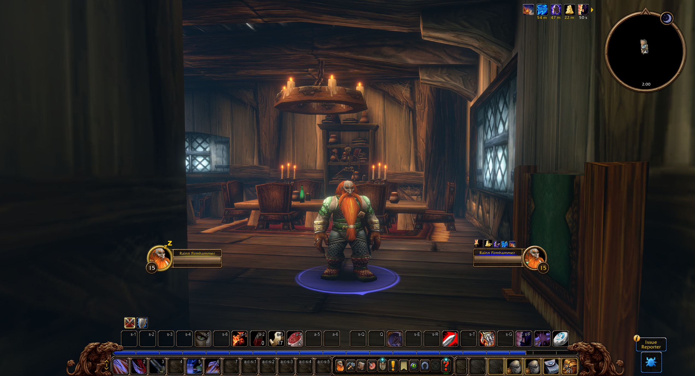

# ErzbaroneUI

A reduced World of Warcraft Classic Era Interface

## Usage

Extract the `ErzbaroneUI` directory from the release zip into the `World of Warcraft\_classic_era_\Interface\AddOns\` directory.
To open the configuration, go to Game Menu → Options → AddOns → ErzbaroneUI or type `/eui`.

## Features

- Auto sell grey items
- Auto repair
- Optional vignette effect
- Five second rule timer on the player mana bar
- Textured health and power bars on the unit frames (classic, smooth, skills or a custom `textures\statusbar` file), also selectable for the cast bars
- Cast count on action buttons (how often a mana spell can be cast with the current mana)
- Red tint on action buttons while the target is out of range
- Hides the button column left of the chat window
- Moves the chat window into the lower left corner
- Hides the vertical action bars on the right until hovered
- Compact minimap: removes the header, places tracking, calendar, mail and addon buttons on the minimap border and shows the server time inside the minimap; the buttons can be hidden until the minimap is hovered

## Screenshots

## Credits

- [FiveSeconRule](https://github.com/smp4903/FiveSecondRule)
- [World of Warcraft Programming](https://wowprogramming.com/index.html)
