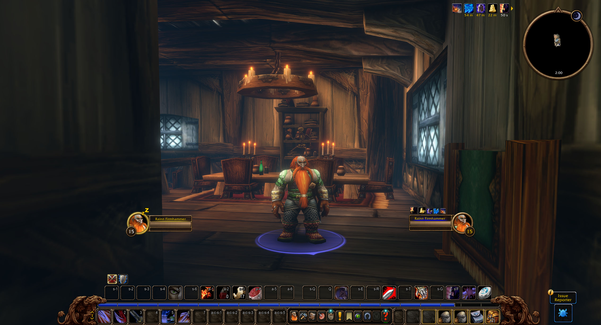
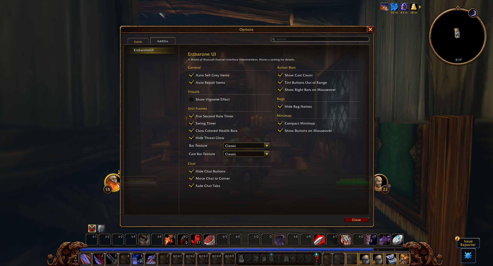
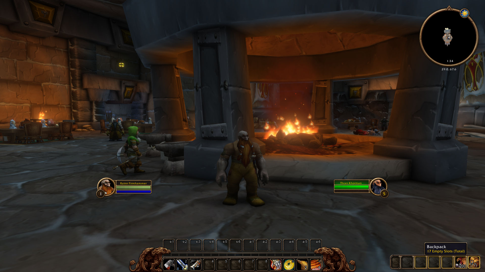

# ErzbaroneUI

A reduced World of Warcraft Forever Interface

## Usage

Extract the `ErzbaroneUI` directory from the release zip into the `World of Warcraft\_forever_\Interface\AddOns\` directory.
To open the configuration, select ErzbaroneUI in the minimap's AddOns menu, go to Game Menu → Options → AddOns → ErzbaroneUI or type `/eui`.
Scroll the settings panel with the mouse wheel or scrollbar to reach all options.

### Via CurseForge

The addon is available on CurseForge too, search for `ErzbaroneUI` or [on their website](https://www.curseforge.com/wow/addons/erzbaroneui).

## Features

- Auto sell grey items
- Auto repair
- Optional vignette effect
- Optional neutral grey decorative frame artwork (disabled by default; requires a UI reload)
- HDR options
- Five second rule timer on the player mana bar
- Optional swing timer spark on the player power bar for melee and ranged fighters
- Textured health and power bars on the unit frames (classic, smooth, skills or a custom `textures\statusbar` file), also selectable for the cast bars
- Class colored health bars for players and grey health bars for creatures tapped by others
- Optional compact remaining-health numbers on enemy nameplates (disabled by default)
- Optionally hides the large threat glow around the player, target and focus frames
- Cast count on action buttons (how often a mana spell can be cast with the current mana)
- Red tint on action buttons while the target is out of range
- Hides the button column left of the chat window
- Hides the chat tabs until the mouse is over the chat window
- Hides the vertical action bars on the right until hovered
- Emote selection beside the mouse cursor, with 36 emotes
- Improved Main Actionbar Layout
- Micro menu position presets
- Hides the bag names in the bag windows
- Compact minimap until the minimap is hovered
- Optional world map hover labels with zone and fishing levels (disabled by default)
- Optional minimalist objective tracker with muted warm grey, outlined quest titles and darker warm grey objectives, retaining their existing shadows without levels, section banners, markers, dashes or action buttons (disabled by default). Left-click a quest to open it in the world map quest log; Shift-left-click to stop tracking it.

## Development

From the addon directory, run all Lua tests with `lua tests\run_test.lua`.
The runner discovers `*_test.lua` files (excluding itself) and runs each in a separate process; it requires PowerShell.
Visual appearance and actual combat protection still need testing in the Forever client.

## Screenshots

## Credits

- [FiveSecondRule](https://github.com/smp4903/FiveSecondRule) and [WeaponSwingTimer](https://github.com/LeftHandedGlove/WeaponSwingTimerAddon) for the idea of the timer sparks on the power bar
- [wow-ui-source](https://github.com/Gethe/wow-ui-source) by Gethe, the Blizzard interface source used as reference
- [wow-ui-source-forever](https://github.com/Ketho/wow-ui-source-forever/tree/forever) by Ketho, the matching Forever FrameXML reference (upstream live sources differ)
- [Warcraft Wiki](https://warcraft.wiki.gg/wiki/World_of_Warcraft_API) for the API documentation
- [World of Warcraft Programming](https://wowprogramming.com/index.html)
