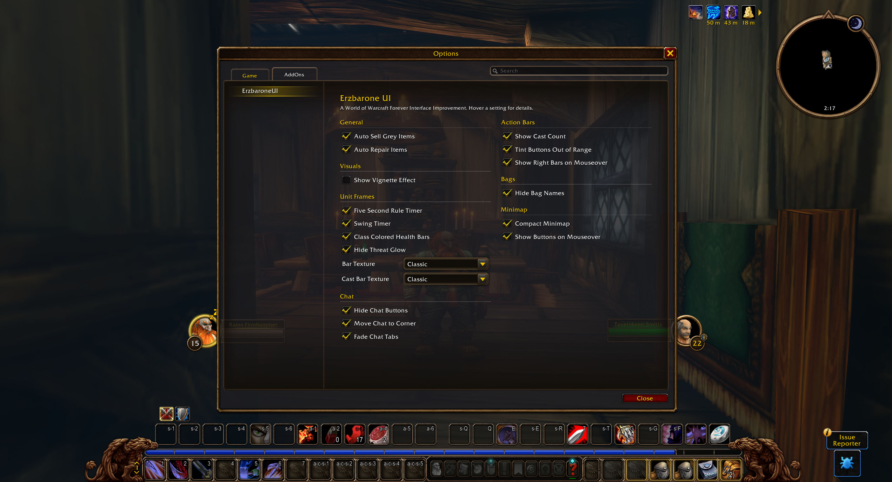

# ErzbaroneUI

A reduced World of Warcraft Forever Interface

## Usage

Extract the `ErzbaroneUI` directory from the release zip into the `World of Warcraft\_forever_\Interface\AddOns\` directory.
To open the configuration, go to Game Menu → Options → AddOns → ErzbaroneUI or type `/eui`.

### Via CurseForge

The addon is available on CurseForge too, search for `ErzbaroneUI` or [on their website](https://www.curseforge.com/wow/addons/erzbaroneui).

## Features

- Auto sell grey items
- Auto repair
- Optional vignette effect
- Five second rule timer on the player mana bar
- Optional swing timer spark on the player power bar for melee and ranged fighters
- Textured health and power bars on the unit frames (classic, smooth, skills or a custom `textures\statusbar` file), also selectable for the cast bars
- Class colored health bars for players and grey health bars for creatures tapped by others
- Optionally hides the large threat glow around the player, target and focus frames
- Cast count on action buttons (how often a mana spell can be cast with the current mana)
- Red tint on action buttons while the target is out of range
- Hides the button column left of the chat window
- Moves the chat window into the lower left corner
- Hides the chat tabs until the mouse is over the chat window
- Hides the vertical action bars on the right until hovered
- Hides the bag names in the bag windows
- Compact minimap: removes the header, places tracking, calendar, mail and addon buttons on the minimap border and shows the server time inside the minimap; the buttons can be hidden until the minimap is hovered

## Screenshots

## Credits

- [FiveSecondRule](https://github.com/smp4903/FiveSecondRule) and [WeaponSwingTimer](https://github.com/LeftHandedGlove/WeaponSwingTimerAddon) for the idea of the timer sparks on the power bar
- [wow-ui-source](https://github.com/Gethe/wow-ui-source) by Gethe, the Blizzard interface source used as reference
- [Warcraft Wiki](https://warcraft.wiki.gg/wiki/World_of_Warcraft_API) for the API documentation
- [World of Warcraft Programming](https://wowprogramming.com/index.html)
